# Offline LaTeX Studio

Write and compile LaTeX reports, theses and slides on your own computer, without an internet
connection. It works like Overleaf's code editor — source on the left, compiled PDF on the
right — with optional automatic backup of every save to your own GitHub account.

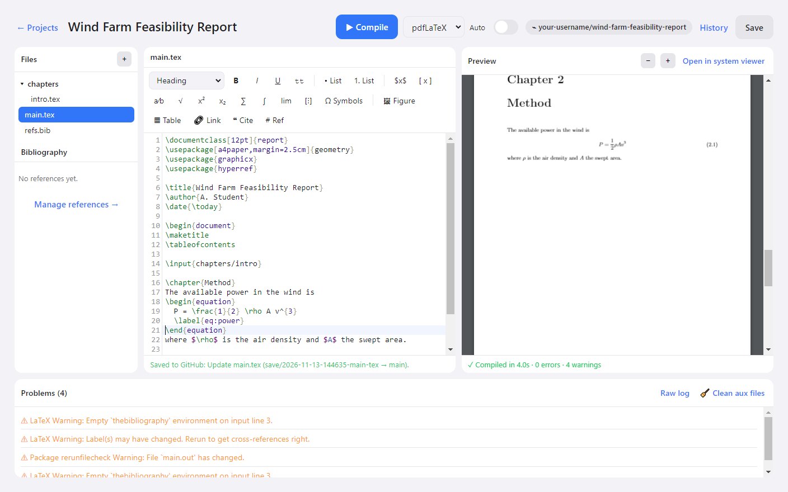

## Contents

- [Download and install (Windows)](#download-and-install-windows)
- [First launch](#first-launch)
- [Connect GitHub](#connect-github)
- [Create and write a project](#create-and-write-a-project)
- [Saving and version history](#saving-and-version-history)
- [Troubleshooting](#troubleshooting)
- [What is not included yet](#what-is-not-included-yet)
- [For developers](#for-developers)

## Download and install (Windows)

You need two things: a LaTeX distribution (the compiler) and this app.

### 1. Install MiKTeX (the LaTeX compiler)

The app does not include LaTeX itself — it uses the one installed on your PC.

1. Download the installer from <https://miktex.org/download> and run it.
2. Choose **Install only for me**.
3. On the settings page, set **Install missing packages on-the-fly** to **Yes**. This lets
   MiKTeX fetch a package the first time a document needs it, instead of stopping with an error.

If you already have MiKTeX or TeX Live, skip this step.

### 2. Install Offline LaTeX Studio

1. Open the [latest release](../../releases/latest) and download
   **`Offline-LaTeX-Studio-Setup-win64.zip`**.
2. Right-click the zip → **Extract All**, then double-click the
   **`Offline LaTeX Studio Setup`** `.exe` inside the extracted folder.
3. Windows may show a blue **"Windows protected your PC"** box, because the installer is not
   code-signed. Click **More info → Run anyway**.
4. Follow the setup wizard. It adds Start Menu and desktop shortcuts. To remove the app later,
   use **Settings → Apps → Installed apps**.

Requires Windows 10 or 11, 64-bit.

## First launch

**Create an account.** Choose **Sign up**, enter an email and a password, and click **Sign up**.
This account exists only on your computer — it is not sent anywhere. (The Google and GitHub
buttons on this screen are not working yet; see [what is not included](#what-is-not-included-yet).)

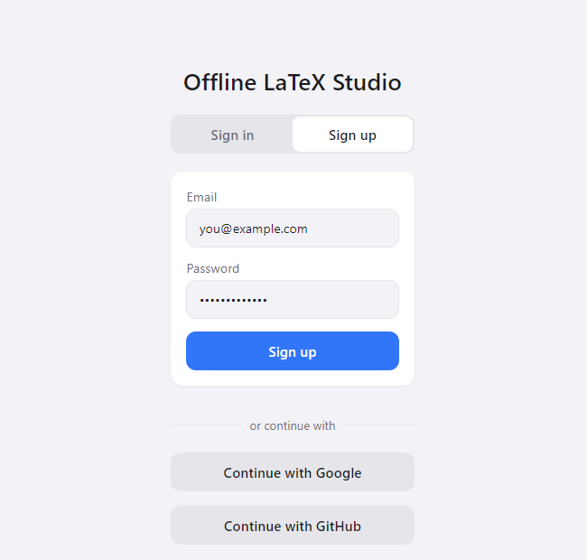

**Choose where your work lives.** You can change this later in Settings.

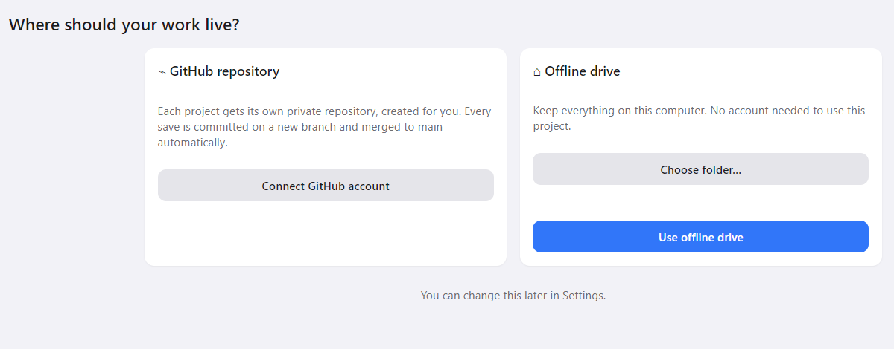

| Option | What it does |
| --- | --- |
| **Offline drive** | Everything stays in a folder on this computer. Each Save keeps a version you can go back to. |
| **GitHub repository** | Projects still live on this computer, and each Save is also uploaded to a private repository in your GitHub account. |

For **Offline drive**, click **Choose folder…** (optional), then **Use offline drive**. For
**GitHub**, follow the next section.

## Connect GitHub

The app connects to GitHub with a **personal access token** — a password-like key you create
in your GitHub account. You do this once.

### Step 1 — Create a token on GitHub

1. Sign in at <https://github.com>, then open
   <https://github.com/settings/tokens> (profile picture → **Settings** → **Developer settings**
   → **Personal access tokens** → **Tokens (classic)**).

   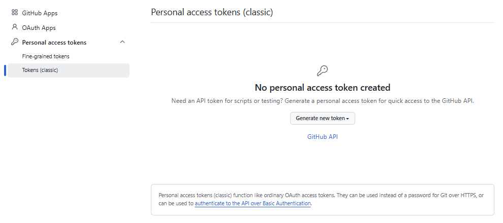

2. Click **Generate new token** → **Generate new token (classic)**.

   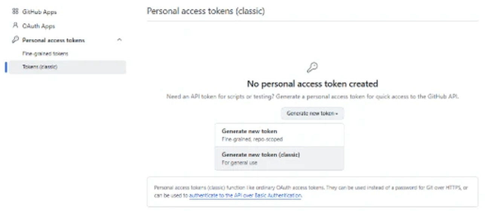

3. Fill in the form:
   - **Note:** anything that reminds you what it is for, e.g. `Offline LaTeX Studio`.
   - **Expiration:** how long the token should work. When it expires you create a new one and
     reconnect.
   - **Select scopes:** tick **`repo`** — the first box. It is the only one the app needs; leave
     all the others unticked.

   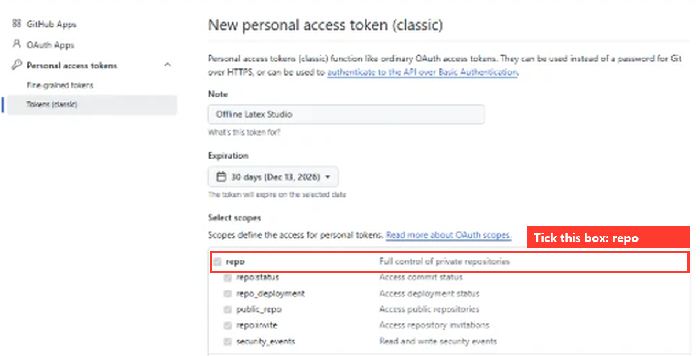

   > Without `repo` the token will connect, but the app will not be able to create a repository
   > or save to it.

4. Scroll down and click **Generate token**.
5. **Copy the token now** (it starts with `ghp_`). GitHub shows it only once.

   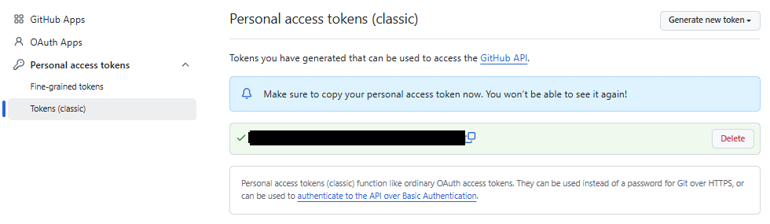

Treat the token like a password: do not share it or paste it into documents.

### Step 2 — Paste it into the app

1. On the **Where should your work live?** screen, click **Connect GitHub account**.
2. Paste the token into **Personal access token** and click **Connect**.

   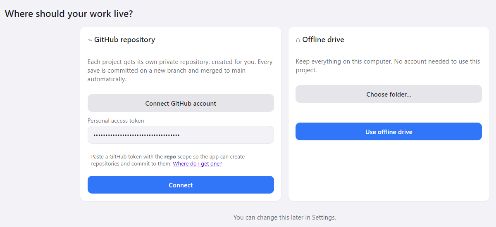

3. When it says **Signed in to GitHub as …**, click **Use GitHub**.

   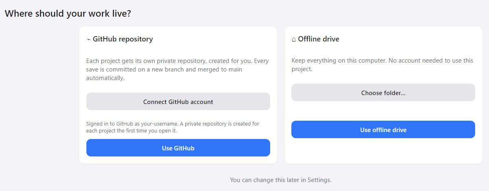

If you chose Offline drive earlier, reach this screen again from **Settings → Switch storage
mode…**.

### What happens after that

- The first time you open a project, the app **creates a private repository** for it, named
  after the project (for example `wind-farm-feasibility-report`), and uploads it.
- Each time you press **Save** (or **Ctrl+S**), the app commits your changes on a new branch
  named `save/<date>-<time>-<file>` and merges it into `main`. There is nothing to type.
- The repository name is shown at the top of the editor, and the line under the editor
  confirms each save.
- If you are offline, your work is still saved on your computer and uploads on the next Save.

The token is stored only in the app's settings on your computer and is sent only to
`api.github.com`. Git does not need to be installed.

## Create and write a project

1. Click **+ New project**.
2. Pick a template (report, thesis, article, slides, letter or CV), fill in the title and
   author, and click **Create**. Projects go in `Documents\Offline LaTeX Studio` unless you
   **Browse…** to another folder.

   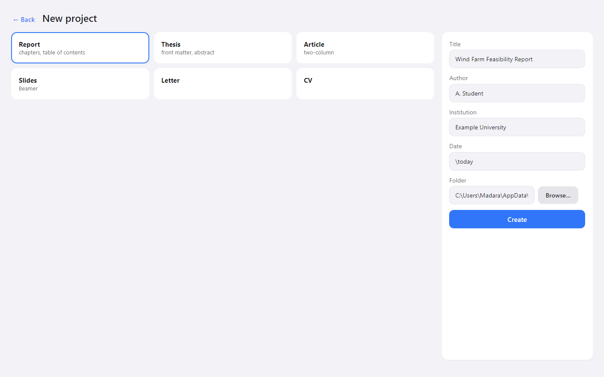

3. The editor opens and compiles the project straight away. Type on the left; press
   **▶ Compile** (or **Ctrl+Enter**) to refresh the PDF on the right. Turn on **Auto** to
   recompile as you type.

To open an existing LaTeX folder instead, use **Open folder…** on the projects screen.

### Writing tools

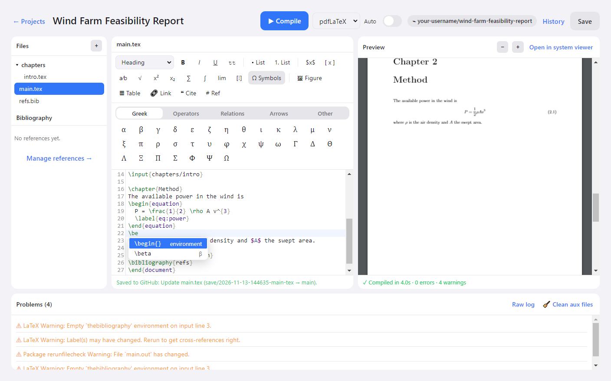

- **Toolbar** — headings, bold/italic/underline, bulleted and numbered lists, inline and
  display maths, fraction, root, superscript/subscript, sum, integral, limit, matrix, figure
  (pick an image; it is copied into the project), table (choose rows and columns), link, cite
  and cross-reference. Select text first to wrap it.
- **Ω Symbols** — click a Greek letter, operator, relation or arrow to insert it. Outside
  maths it is wrapped in `$…$` for you.
- **Suggestions** — type `\` and a list of commands appears. It also suggests environment names
  after `\begin{`, your reference keys after `\cite{`, your labels after `\ref{`, and package
  names after `\usepackage{`. Press **Enter** to accept, **Esc** to dismiss.
- **Auto-closing** — `\begin{…}` followed by Enter adds the matching `\end{…}`; brackets and
  `$` close themselves.
- **Problems** — errors and warnings are listed under the editor. Click the underlined file
  and line to jump there. **Raw log** shows the full compiler output.
- **Bibliography** — **Manage references →** adds, edits, searches and imports `.bib` entries.

| Shortcut | Action |
| --- | --- |
| Ctrl+Enter | Compile |
| Ctrl+S | Save (version, and GitHub commit if connected) |
| Ctrl+B / Ctrl+I | Bold / italic |
| Ctrl+Space | Show suggestions |
| Ctrl+F | Find |
| Ctrl+/ | Comment or uncomment the line |

## Saving and version history

Your typing is written to disk automatically. **Save** (Ctrl+S) additionally records a version:

- **Offline drive:** a restorable copy is kept inside the project's `.history` folder.
- **GitHub:** a commit is made in the project's repository (see above).

Click **History** to list saved versions and **Restore** one. The version you had before
restoring is kept in the list too, so a restore can be undone.

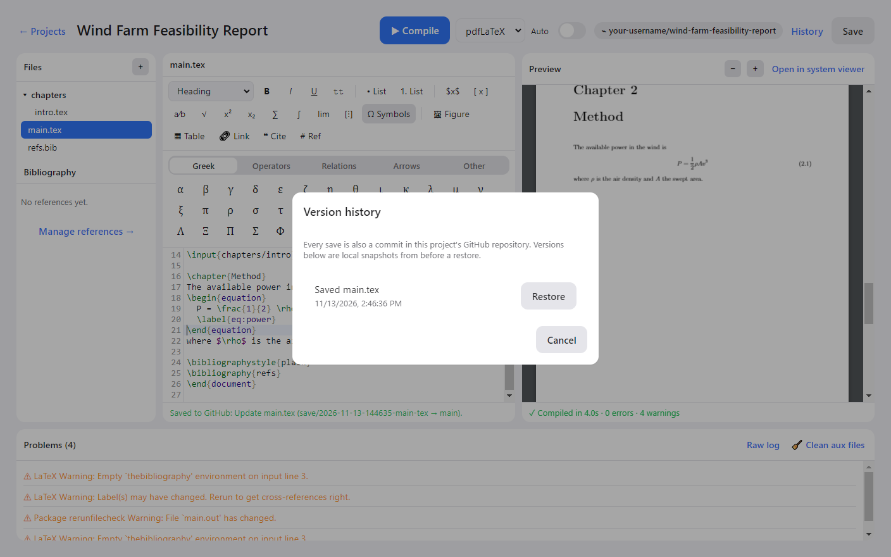

The compiled PDF is next to your `.tex` file in the project folder, and **Open in system
viewer** opens it in your PDF reader.

## Troubleshooting

| Problem | What to do |
| --- | --- |
| "No TeX distribution was found" | Install MiKTeX (see above), then restart the app. If it is installed somewhere unusual, use **Point at a TeX install folder…** and pick the folder containing `pdflatex.exe`. |
| First compile is slow or stops at the time limit | MiKTeX is downloading packages the document needs. Compile again; raise **Stop compile after** in Settings if needed. |
| "No PDF was produced" | Click **Raw log** under the editor for the compiler's own message. A package MiKTeX could not download (no internet) is the usual cause. |
| "GitHub would not allow creating a repository" | The token is missing the `repo` scope. Create a new token with `repo` ticked and reconnect. |
| "GitHub rejected the access token" | The token expired or was deleted. Create a new one and reconnect via **Settings → Switch storage mode…**. |
| "Windows protected your PC" during install | Click **More info → Run anyway**. The installer is not code-signed. |

## What is not included yet

- **Sign in with Google / GitHub** — the buttons are placeholders. Use the email sign-up and,
  for GitHub, a token as described above.
- **A bundled LaTeX compiler** — MiKTeX or TeX Live must be installed separately.
- **Visual (rich-text) editing and live maths preview** — the editor is source-only.
- **Spell check, DOI lookup, PDF/A and Word export, a Git diff view.**
- **macOS and Linux installers** — the app builds for both from this source, but only the
  Windows installer has been tested.

## Privacy

Accounts, projects, compiled PDFs and local history stay on your computer. The only network
calls the app makes are to `api.github.com`, and only after you connect GitHub. (MiKTeX may
separately download LaTeX packages.)

## For developers

```
npm install
npm start
```

```
npm run dist:win     # Setup.exe (NSIS) + portable .exe, on Windows
npm run dist:mac     # .dmg + .zip, on macOS
npm run dist:linux   # .AppImage + .deb, on Linux
```

Each installer can only be built on its own OS. Pushing a tag like `v0.2.0` runs
`.github/workflows/build.yml`, which builds all three on GitHub's runners and attaches them to
the release. On Windows, build from a short path such as `C:\build\` — NSIS cannot open paths
longer than about 260 characters.

```
main.js        Electron main process — file, compile and GitHub work happens here
preload.js     the only bridge from the UI into the main process
src/           the UI: index.html, styles.css, app.js, latex-tools.js, vendor/ (pdf.js)
lib/           texDetect, compile, storage, github, bib, wordcount, templates
docs/images/   screenshots used in this README
```

Licence: MIT.
